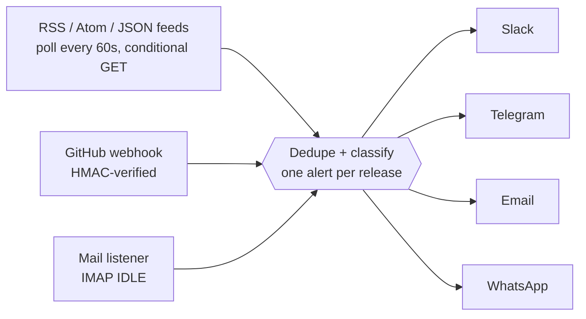

# release-radar

**Release and security alerts for the stack you actually run.** Watches PHP, Node.js, Java, your libraries and CISA's exploited-vulnerability list, and pushes to Slack, Telegram, email and WhatsApp the moment something is published, instead of whenever you next happen to check.

Two ways to use it:

- **`npx release-radar`**: run it inside any project. It reads `package.json` / `composer.json` (and their lockfiles) and tells you which of **your exact dependency versions** have known vulnerabilities.
- **`release-radar daemon`**: an always-on service that watches feeds, GitHub and mailing lists and alerts you the moment something is published.

Self-hosted, one small Node.js process, no database, no API keys.

## How it works

Three ingest paths feed **one** deduplicated pipeline, which fans out to every channel you've configured.



| Path | Typical latency | Works for |
|---|---|---|
| **Poll** (60s, conditional GET) | up to ~60s | any RSS/Atom/JSON feed, any public repo's `releases.atom`, CISA KEV |
| **GitHub webhook** | seconds | repos/orgs **you admin** |
| **Mail listener** (IMAP IDLE) | seconds | mailing lists (php.internals, oss-security, ...) and GitHub "Watch > Releases" on **any** repo |

The same release arriving through several paths alerts **once** (GitHub URLs are the dedupe key). Every alert shows when it was *published*, when it was *detected*, and the gap between them, so you can measure your own latency instead of trusting this table.

Items are classified as **security** when their title or summary matches `securityKeywords` (word-boundary aware: `RCE` matches "RCE", not "source"). Each source decides whether to alert on `all` items or only `security` ones.

## Scan your project (npx)

From a project directory:

```bash
npx release-radar              # scans ./package.json and ./composer.json
npx release-radar ../my-app    # or point it at a directory
```

```
release-radar scan: my-app
Read: package.json, package-lock.json, composer.json, composer.lock
Checked 412 npm + 96 Packagist packages against OSV.dev

 CRITICAL qs@6.5.0  (transitive, prod)
          GHSA-xxxx / CVE-2022-24999  CVSS 9.8
          qs prototype pollution
          Fix: upgrade to 6.5.3 or later
          https://osv.dev/vulnerability/GHSA-xxxx
```

It checks the versions you actually have, not the ranges you declared:

| Ecosystem | Exact versions come from | Fallbacks (with a warning printed) |
|---|---|---|
| npm | `package-lock.json` / `npm-shrinkwrap.json`, **including transitive dependencies** | installed `node_modules/<pkg>`, then the lowest version the range allows |
| Composer (Packagist) | `composer.lock`, **including transitive dependencies** | the lowest version the constraint allows |

Data comes from [OSV.dev](https://osv.dev) (GitHub Security Advisories, the PHP security-advisories database and more). No account or key is needed, and only package names and versions are sent, never your code.

| Option | Effect |
|---|---|
| `--min-severity <level>` | `low`, `moderate`, `high` or `critical`. Hide anything below it. Advisories with no rating are always shown |
| `--prod` | Skip `devDependencies` / `require-dev` |
| `--ignore <GHSA-or-CVE>` | Ignore an advisory you've assessed (repeatable) |
| `--notify` | Also send **one** summary alert to your Slack / Telegram / email / WhatsApp |
| `--env-file <path>` | Where to read channel settings for `--notify`. The scanned project's own `.env` is **never** read |
| `--json` | Machine-readable output |
| `--no-fail` | Always exit 0 |

**Exit codes:** `0` clean, `1` vulnerabilities found, `2` error. That makes it a drop-in CI gate:

```yaml
- run: npx release-radar --min-severity high --prod
```

Run the always-on service the same way: `npx release-radar daemon` (flags: `--once`, `--dry`, `--replay N`, `--test-alert`).

> **Scope.** This reports *known* vulnerabilities in the *versions you have installed*. It does not tell you whether your code calls the vulnerable function, and it doesn't check the PHP or Node.js runtime version itself (the daemon's feeds are for that). `yarn.lock` and `pnpm-lock.yaml` aren't read yet: without a `package-lock.json` only direct dependencies are checked, and the report says so.

## Quick start

Requires **Node.js 22+**.

```bash
npm install
npm run demo        # no setup: fetches your real feeds and prints the 2 newest alerts per source to the console
```

Then wire up real channels:

```bash
cp .env.example .env     # fill in only the channels you want; empty ones are skipped
npm run test-alert       # sends a test message through every configured channel; exit code 1 if any fails
npm run build
npm start                # runs forever; Ctrl+C / SIGTERM shuts down cleanly
```

> **First start is silent on purpose.** Each source is *baselined* the first time it is polled (you'll see `baselined N existing items`), so you aren't flooded with the whole back catalogue. Only releases published afterwards alert. `npm run demo` and `--replay N` exist so you can see real alerts immediately.

### CLI flags

| Flag | Effect |
|---|---|
| `--dry` | Print alerts to the console; send nothing, and never read or write `state.json` (a dry run can't "use up" real alerts) |
| `--once` | Poll every source once and exit (cron-friendly; exit code 1 if any source failed). Webhook and mail listener are not started |
| `--replay N` | On a source's *first* poll, also alert its newest N items instead of staying fully silent |
| `--test-alert` | Send one test alert through every configured channel, report per channel, exit |

### npm scripts

| Script | What it does |
|---|---|
| `npm run dev` | Run from source with `tsx` |
| `npm run build` / `npm start` | Compile to `dist/` / run the compiled build |
| `npm run demo` | Dry run, once, replay 2 (try it without any credentials) |
| `npm run test-alert` | Verify every configured channel |
| `npm run check:feeds` | Fetch every source in `sources.json` and report item counts; flags dead URLs and empty feeds |
| `npm test` / `npm run typecheck` | Test suite / TypeScript check |
| `npm run verify` | Everything CI runs: typecheck, tests, build, dependency audit |

## Channels

Use any combination. A channel whose variables are empty is skipped. Settings come from the environment or a `.env` file (real environment variables win).

| Channel | Variables | Notes |
|---|---|---|
| Slack | `SLACK_WEBHOOK_URL` | Incoming Webhook URL (treat as a secret). Message text is escaped so feed or email content can't trigger `@channel` pings |
| Telegram | `TELEGRAM_BOT_TOKEN`, `TELEGRAM_CHAT_ID` | Bot from @BotFather |
| Email | `SMTP_HOST`, `SMTP_PORT`, `SMTP_USER`, `SMTP_PASS`, `MAIL_FROM`, `MAIL_TO` | Port 465 uses implicit TLS; 587/25 use STARTTLS |
| WhatsApp | `WA_TOKEN`, `WA_PHONE_ID`, `WA_TO`, `WA_TEMPLATE`, `WA_LANG`, `WA_API_VERSION` | Meta Cloud API. Needs an **approved template with exactly one body variable** `{{1}}`. Meta retires Graph API versions about two years after the next one ships, so set `WA_API_VERSION` deliberately |

Other settings: `DISPLAY_TZ` (timestamp display, default `UTC`; invalid values fall back to UTC), `STATE_FILE` (default `state.json`), `SOURCES_FILE` (default `sources.json`), `WEBHOOK_HOST` (default `0.0.0.0`).

## Configuring sources: `sources.json`

```jsonc
{
  "pollSeconds": 60,                       // minimum 30
  "securityKeywords": ["CVE-", "security", "vulnerab", "RCE", "..."],
  "webhook": { "port": 8787, "notify": "all" },
  "mail": { "rules": [ /* see below */ ] },
  "sources": [
    { "name": "PHP",       "type": "feed", "url": "https://www.php.net/feed.atom", "notify": "all" },
    { "name": "CISA KEV",  "type": "kev",  "url": "https://www.cisa.gov/.../known_exploited_vulnerabilities.json", "notify": "all" }
  ]
}
```

- `type`: `feed` (Atom or RSS 2.0) or `kev` (CISA Known Exploited Vulnerabilities JSON).
- `notify`: `"all"` alerts on everything new; `"security"` only on keyword matches.
- Source `name` must be unique. It keys the dedupe and baseline state.
- The file is validated on startup and **every** problem is reported at once.
- Keyword matching: keywords match at the start of a word. Keywords of four characters or fewer (`RCE`) must also end at a word boundary; longer ones act as stems (`vulnerab` matches "vulnerability").
- Any GitHub repo's `https://github.com/<owner>/<repo>/releases.atom` works as a feed with no token. Run `npm run check:feeds` after editing to confirm every URL returns real entries.

## GitHub webhook (repos/orgs you admin)

1. Set `GITHUB_WEBHOOK_SECRET` (`openssl rand -hex 32`). Expose port 8787 over **HTTPS** with a reverse proxy, or `cloudflared tunnel --url http://localhost:8787`.
2. Repo or org, Settings, Webhooks: payload URL `https://<host>/webhook/github`, content type `application/json`, the same secret, events **Releases** and **Repository security advisories**.
3. Requests are verified with HMAC-SHA256 (constant-time). Unsigned or wrongly signed requests get `401`. Bodies over 1 MB get `413`. `GET /healthz` returns `200 ok`.

> Tag-creation events are supported but optional. A tag event and the release event for the same tag share one dedupe key, and the tag event usually arrives first, so the later release (which may carry the security keywords) is suppressed. Enable tag events only for repos that don't publish GitHub Releases.

## Mail listener (IMAP IDLE)

Use a **dedicated mailbox** (Gmail needs IMAP enabled and an app password). Subscribe it to mailing lists, and on GitHub use *Watch, Custom, Releases* for repos you can't add webhooks to.

```jsonc
"mail": { "rules": [
  { "name": "oss-security", "listId": "oss-security", "notify": "all" },
  { "name": "GitHub watch", "from": "notifications@github.com", "subjectContains": "Release",
    "notify": "all", "requireAuth": true }
]}
```

- A rule matches when **all** of its fields match (case-insensitive substrings of `From`, `List-Id`, subject). Every rule needs at least one field. First matching rule wins.
- `requireAuth: true` drops mail unless your mail provider's `Authentication-Results` header shows a passing, From-aligned DKIM or DMARC result. This stops anyone who can email the mailbox from spoofing `notifications@github.com` and pushing a fake alert with a phishing link to your phone. Use it for direct senders like GitHub. Mailing-list mail is usually re-signed by the list, so leave it off there.
- The first start baselines the mailbox, so old mail never alerts. Undeliverable alerts are retried every 60 seconds and the mailbox position does not advance past them.
- **Verify your rule strings against a real email's raw headers once**, especially `List-Id` and `Authentication-Results`.

## Delivery and dedupe semantics

- **One alert per release** across all paths (webhook, mail and feed collapse to the same key).
- **No silent loss when every channel is down.** The item is released back to the pipeline and retried: on the next poll for feeds, within 60 seconds for mail. For feeds the HTTP cache is dropped too, so a `304 Not Modified` can't hide the retry.
- **One channel failing never blocks the others.** If Slack is down but Telegram works, the alert counts as delivered and Slack is *not* retried.
- **Webhooks can't be retried by us** (GitHub doesn't redeliver after we answer `202`). If you care, also list the repo's `releases.atom` as a poll source: it acts as a backstop and dedupes against the webhook.
- **At-least-once around crashes.** State is saved atomically after alerting. A hard kill between the alert and the save can repeat that one alert on restart. It can't flood you.
- State lives in `state.json`. A corrupt file is moved aside (`state.json.corrupt-<time>`) with a loud log line rather than silently reset. It grows roughly 100 bytes per item ever seen and is not pruned (feeds like CISA KEV list their full history, so pruning would re-alert).

## Deployment

**Docker**

```bash
docker build -t release-radar .
docker run -d --name release-radar --restart unless-stopped \
  --env-file .env -p 8787:8787 -v radar-data:/data release-radar
```

State is stored at `/data/state.json` (mount a volume or you re-baseline on every container replacement). The image runs as a non-root user. Poll-only deployments can omit `-p`.

**systemd**

```ini
[Service]
WorkingDirectory=/opt/release-radar     # .env is loaded from here
ExecStart=/usr/bin/node dist/index.js
Restart=always
User=radar
TimeoutStopSec=15
```

**pm2**: `pm2 start dist/index.js --name release-radar`

**cron (poll only)**: `*/5 * * * * cd /opt/release-radar && node dist/index.js --once`

## Security notes

- Secrets only ever come from the environment / `.env`. `.env` and `state*.json` are in `.gitignore`.
- Error logs show **host names only**, never URLs: Slack webhook URLs and Telegram bot tokens live in the URL path and would otherwise leak into your log files.
- Feed and email text is untrusted. It is HTML-stripped and length-capped, and escaped for Slack.
- Run the webhook behind HTTPS. Bind to `127.0.0.1` (`WEBHOOK_HOST`) when a reverse proxy runs on the same host.
- Report vulnerabilities privately (see the repository's Security tab).

## Known limitations

- `scan` needs network access to `api.osv.dev` (set `OSV_API_URL` to use a mirror). Not yet supported: `yarn.lock`, `pnpm-lock.yaml`, Composer `dev-*` branch versions.
- Alerts go to one recipient per channel (one Slack webhook, one chat id, one `MAIL_TO`, one WhatsApp number).
- No per-repo filter for pre-releases or drafts on poll/mail paths (draft webhooks are ignored).
- Tag-only feeds such as `.../tags.atom` can be noisy (every build tag alerts). Check volume with `npm run check:feeds` before using `notify: "all"`.
- Not tested against a live IMAP server in CI. Treat the mail listener as the path to verify first on your own mailbox.

## Development

```bash
npm install
npm run verify      # typecheck + tests + build + audit; same as CI
```

Layout: `src/cli.ts` (`npx` entry: `scan` and `daemon`) · `src/scan/` (manifest readers, OSV client, CVSS, report) · `src/index.ts` (daemon wiring, flags, shutdown) · `runner.ts` (one poll cycle) · `pipeline.ts` (dedupe, delivery, retry) · `sources.ts` (fetch and parse) · `webhook.ts` · `mail.ts` · `notifiers.ts` · `config.ts` (validation) · `store.ts` (atomic state).

Tests use Node's built-in runner (`node:test`) and cover signature verification, event mapping, feed parsing, dedupe across paths, delivery failure and retry, secret redaction, config validation and state recovery.

## License

[MIT](LICENSE)
